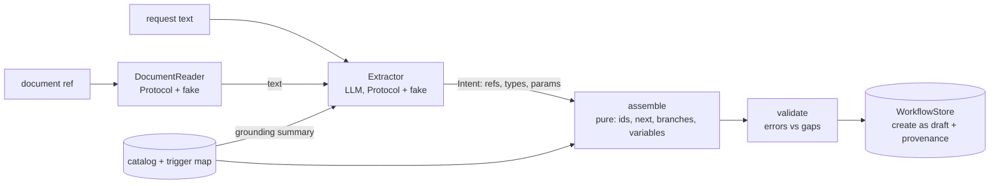
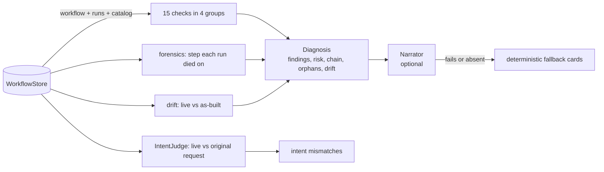

# workflow-doctor

Build automation workflows from plain language, and diagnose why existing ones fail and exactly how to fix them.

[](https://github.com/Tayyab-Bilal/workflow-doctor/actions/workflows/ci.yml)

> An open-source reference implementation of building and diagnosing automation workflows from plain language. All names and data are fictional.

## At a glance

**What it is.** A small library that builds automation workflows from plain language and diagnoses why existing ones fail. An LLM only reads the request; ordinary code does all the wiring and all the checking.

**What is built.**
- Build from text or a document: extract, assemble, validate, store as a draft (`builder/build.py: build`, `store.py: build_and_store`, `documents.py: build_from_document`).
- Graph assembly with fresh ids, branches and variables (`builder/assembler.py: assemble`).
- Two-tier validation with cycle detection (`builder/validator.py: validate`).
- 15 deterministic checks in 4 groups, a risk level and per-run forensics (`doctor/checks.py: ALL_CHECKS`, `doctor/diagnose.py: diagnose`, `doctor/forensics.py: run_failures`).
- Three-way drift (`doctor/drift.py: intent_drift`).
- Explanation cards with a deterministic fallback (`doctor/narrate.py: narrate`).
- Agent-facing find, copy, edit, publish and revert (`ops.py`).

**What is not built or simplified.** There is no real LLM or real engine: every LLM sits behind a Protocol with a scripted fake, and the store is synchronous and in memory. Variables are rewritten in top-level string params only. Termination is not checked per branch. See "Limits & known trade-offs" below.

**How it flows.**
1. A request (or a document turned into text) goes to the extractor together with a summary of the catalog.
2. The extractor returns an intent: throwaway refs, node types, params and who points where.
3. The assembler mints real ids and rewrites every pointer and variable.
4. The validator splits problems into blocking errors and fillable gaps.
5. The store saves the result as a draft with a record of what was built.
6. The Doctor later runs its checks on the live workflow and its run history.
7. Drift compares the live graph with the as-built record and, through a judge, with the original request.
8. The narrator turns findings into readable cards, or a fallback does it if the narrator is missing or fails.

**Run it.** `.venv/bin/pytest -q` gives 92 passed. `.venv/bin/python examples/demo.py` runs the whole story with no network.

## How each part works, one by one

### 1. The model never writes the graph, code does

- **Risk / problem:** An LLM asked to emit a workflow graph makes up ids and leaves branches pointing at nothing.
- **How it works:**
  - The model only returns an intent: short throwaway names, node types, settings and which name points at which. It never produces a real id (`builder/extract.py: Intent`).
  - Plain code then mints a fresh random id for every step and swaps every throwaway name for it, so any id the model tried to supply is simply ignored (`builder/assembler.py: assemble`).
  - Placeholders in settings, like the trigger's owner email, are rewritten to point at the new ids too. If the model says "trigger" instead of its own name for the trigger, that still resolves (`model.py: rewrite_variables`).
  - The first step is wired from the trigger by default, and every other link must be stated, so nothing is joined by a guess.
  - A simplification: only top-level text settings are rewritten, not nested values.
- **Tests that prove it:** `tests/test_builder.py`: `test_llm_never_sets_ids`, `test_branches_wired_from_refs`, `test_variables_rewritten_to_step_ids`, and 7 more in that file.

### 2. Unknown things are reported, never faked

- **Risk / problem:** If the model asks for a node the engine does not have, quietly swapping in the nearest real one builds a workflow that does something else.
- **How it works:**
  - Every node type is looked up in the engine's catalog. Anything not in it is dropped from the build and listed as unsupported (`builder/assembler.py: assemble`).
  - If the unknown node had true and false branches, it is reported as an unsupported condition. It is never replaced by one of the allowed conditions.
  - The extractor is told the catalog up front: allowed values, the allow-list of conditions, trigger payload fields and the variable syntax, so it makes fewer wrong asks (`model.py: catalog_summary`).
  - A missing setting is never invented. It comes back as a gap for the user to fill (`builder/validator.py: validate`).
  - The phrase-to-trigger table is checked against the catalog in both directions, so a new engine trigger fails the tests until it is mapped (`triggers.py: TRIGGER_MAP`).
- **Tests that prove it:** `tests/test_builder.py`: `test_unknown_condition_not_faked`, `test_unknown_node_goes_to_unsupported`, `test_missing_required_param_is_gap_not_error`, and 7 more in that file. `tests/test_grounding.py`: `test_every_mapped_trigger_exists_in_the_catalog`, `test_every_catalog_trigger_is_mapped`, and 8 more in that file.

### 3. Two-tier validation

- **Risk / problem:** One list of problems either blocks half-finished drafts or lets broken graphs through.
- **How it works:**
  - Structural problems are errors: no trigger, an id used twice, a pointer to a missing step, a condition without both branches, or a loop. Errors stop the workflow being stored (`builder/validator.py: validate`, `store.py: build_and_store`).
  - Empty required settings are gaps. They do not block, because the user can still fill them in. The store always creates a draft either way (`store.py: InMemoryStore.create`).
  - Loops are found by walking the graph and marking each step as in progress or finished. Meeting a step that is still in progress means a loop. Meeting a finished one is just two paths joining, which is allowed (`builder/validator.py: _find_cycle`).
  - Zero and false count as real values. Only missing, blank or empty values count as empty (`model.py: is_empty`).
- **Tests that prove it:** `tests/test_validator.py`: `test_cycle_detected_dfs`, `test_self_loop_is_a_cycle`, `test_diamond_is_not_a_cycle`, and 4 more in that file. `tests/test_store.py`: `test_store_forces_draft_even_if_caller_says_active`, `test_gaps_still_create_but_errors_block_creation`, and 3 more in that file.

### 4. Findings point at the exact step

- **Risk / problem:** A diagnosis that says "a Send Email step is broken" blames every email step in the workflow. A flow check that only follows the main chain calls a whole branch unreachable.
- **How it works:**
  - There are 15 small checks in four groups: trigger, step and settings, flow, and run health. Each one takes the workflow, the catalog and the run history and returns findings, so each can be tested alone (`doctor/checks.py: CHECK_GROUPS`).
  - Every finding carries the step id, a message specific to that step, and a fix naming the setting and the value to use.
  - Reachability walks from the trigger across the next, true and false links, so both sides of a condition count (`model.py: Workflow.walk`).
  - A placeholder is flagged when the step that produces it is not upstream of the step that reads it. This catches values that look filled in but can never resolve (`doctor/checks.py: dead_variable`).
  - For each failed run, the Doctor names the step it died on, or says it failed before any step ran. The risk level is the worst finding, bumped one notch up if runs have failed (`doctor/forensics.py: run_failures`, `doctor/diagnose.py: derive_risk`).
- **Tests that prove it:** `tests/test_checks.py`: `test_gap_matches_exact_step`, `test_reachability_follows_both_branches`, `test_variable_from_downstream_step_is_dead`, and 26 more in that file. `tests/test_diagnose.py`: `test_failure_names_exact_step`, `test_risk_level_derivation`, and 5 more in that file.

### 5. Drift compares only what the builder set

- **Risk / problem:** Engines add default values later. If every extra key counted as a change, healthy workflows would show false drift. Real edits would be buried.
- **How it works:**
  - When a workflow is built, a snapshot of its steps and settings is saved with it (`builder/assembler.py: assemble`).
  - Later, each setting the builder wrote is compared with the live value. Keys the engine added since are ignored, but a key that was removed or changed is reported with its old value (`doctor/drift.py: detect_drift_report`).
  - Added steps, removed steps, changed node types and changed links are reported too. Steps are matched by id, never by type.
  - The third leg asks a judge whether the live workflow still does what the original request said. That is the only part that needs an LLM, and it only runs if a judge and a saved request exist (`doctor/drift.py: intent_drift`).
- **Tests that prove it:** `tests/test_drift.py`: `test_step_removed_added_and_changed_with_as_built_values`, `test_drift_on_the_false_branch_is_found`, `test_steps_of_the_same_type_are_told_apart_by_id`, and 3 more in that file. `tests/test_checks.py`: `test_engine_backfill_is_not_drift`, `test_changed_builder_key_is_drift`, and `test_key_removed_since_build_is_drift`.

### 6. The explanation never depends on the LLM

- **Risk / problem:** If the explanation layer fails or is missing, the user loses the diagnosis.
- **How it works:**
  - Findings are produced by plain code first. The narrator only rewrites them into cards with a cause, evidence, numbered fix and impact (`doctor/narrate.py: narrate`).
  - If the narrator is absent, raises an error or returns nothing, a deterministic fallback builds the same cards straight from the findings (`doctor/narrate.py: fallback_cards`).
  - The error is logged and swallowed, so the user still gets the full answer.
- **Tests that prove it:** `tests/test_diagnose.py`: `test_narrator_failure_falls_back`, `test_narrator_output_used_when_it_works`, `test_no_narrator_uses_deterministic_text`.

### 7. Safe operations for an agent

- **Risk / problem:** An agent that edits live workflows in place, or deletes them, can do damage that cannot be undone.
- **How it works:**
  - Every operation returns a new object and saves nothing. The caller saves, and the confirm-with-the-user step belongs to the agent, not here (`ops.py: apply_edit`).
  - Published workflows are immutable. Edits and reverts on them are refused, and there is no delete operation at all (`ops.py: PublishedWorkflowError`).
  - Publishing runs the validator first and refuses if there is any structural error or empty required setting (`ops.py: publish`).
  - A copy gets new ids for the workflow and every step, with links and placeholders moved to the new ids, and edits applied in the same call. A link to a step that never existed stays as it was, so a copy of a broken workflow is equally broken (`ops.py: copy_workflow`).
  - Revert puts back the saved as-built graph, and a proposed drift fix sets each drifted setting back to its old value (`ops.py: revert`, `ops.py: drift_edits`).
  - Finding by name returns one, several or none. With several it asks, and never picks one (`ops.py: find_by_name`).
- **Tests that prove it:** `tests/test_ops.py`: `test_apply_edit_refuses_published_workflow`, `test_publish_requires_a_valid_workflow_and_then_blocks_edits`, `test_copy_gets_new_ids_and_rewires_every_link_and_variable`, and 10 more in that file.

(Most of this is also summarised in "Design decisions" below.)

## The problem

Customers automate processes in a workflow engine: a trigger, then steps, then TRUE/FALSE conditions.
Workflows break silently. Steps point at removed nodes, required settings are empty, conditions are not on
the engine's allow-list, drafts never fire, and runs fail with opaque errors. Building one by hand means
wiring a graph of GUIDs, and an LLM cannot be trusted to emit GUIDs or branch wiring.

This repo solves two jobs for a fictional "Acme Workspace" app. **Build** a workflow from a sentence or a
policy document. **Diagnose** an existing workflow and its run history: why it fails, what changed since it
was built, and the exact step, setting and value to fix. Both are plain functions, so a one-shot endpoint
and a conversational agent can share them and never disagree.

## What it does

- **Builds from text** (`build`): an LLM extracts structure and intent only; deterministic code makes every
  id, the next-step chain, TRUE/FALSE wiring and variable references. Always a draft. Missing values come back
  as `gaps`; impossible asks come back as `unsupported`. (`builder/`)
- **Builds from a document** (`build_from_document`): a `DocumentReader` turns a reference into text, which
  goes through the same pipeline. (`documents.py`)
- **Grounds the extractor** (`catalog_summary`): node allowed values, the condition allow-list, trigger
  payload fields, trigger phrases and the variable syntax. (`model.py`, `triggers.py`)
- **Validates in two tiers**: structural errors (duplicate ids, dangling pointers, missing branches, cycles by
  3-colour DFS) block; completeness gaps do not. (`builder/validator.py`)
- **Diagnoses** (`diagnose`, `analyse`): 15 deterministic checks in 4 groups, a risk level, the step chain in run
  order, orphans, and the exact step each failed run died on. (`doctor/`)
- **Reports three-way intent drift**: live vs as-built (steps added, removed, changed, with the as-built
  values) and live vs the original request through an `IntentJudge`. (`doctor/drift.py`)
- **Explains** (`narrate`): cause, evidence, numbered fix and impact cards, with a deterministic fallback when
  the narrator is missing or fails. (`doctor/narrate.py`)
- **Agent-facing operations** (`ops.py`): `find_by_name`, `copy_workflow`, `apply_edit`, `publish`, `revert`,
  `drift_edits`. Published workflows are immutable and there is no delete.
- **Seams** with in-memory fakes: `WorkflowStore`, `DocumentReader`, `Extractor`, `Narrator`, `IntentJudge`.

## Quickstart

```bash
uv venv .venv && uv pip install -e ".[dev]"
.venv/bin/pytest -q
.venv/bin/python examples/demo.py
```

No network and no API keys: every LLM sits behind a small Protocol with a scripted fake.

```python
import asyncio

from workflow_doctor import FakeExtractor, Intent, NodeIntent, build, diagnose, load_catalog

catalog = load_catalog()
intent = Intent(
    trigger=NodeIntent(ref="t", node_type="TaskCreated", then="n"),
    steps=[NodeIntent(ref="n", node_type="Notify",
                      params={"user": "{{trigger.owner_email}}", "message": "Task {{trigger.task_title}} created"})],
)
result = asyncio.run(build("when a task is created, notify the owner", FakeExtractor(intent), catalog))
print(result.workflow.status, result.gaps, result.unsupported, result.errors)
print(diagnose(result.workflow, catalog, runs=[]).risk)
```

Excerpt of the demo's output (it builds a workflow, diagnoses a broken one, then walks the agent-facing calls):

```text
=== 2. DIAGNOSE 'Onboarding' ===
risk: HIGH   chain: t1 -> s1 -> s2 -> s3 -> s4 -> s5   orphans: ['s9']

findings:
  [high  ] STEP_NODE_REMOVED      s5  Step s5 uses node LegacyChatPing, which no longer exists in the catalog.
  [high  ] EMPTY_REQUIRED_PARAM   s2  Step s2 has no value for required setting 'to'.
  [medium] INVALID_STATUS_PARAM   s4  Step s4 sets status='finished', which UpdateTaskStatus rejects.
  [low   ] ZERO_DELAY             s3  Delay step s3 waits 0 minutes, so it does nothing.
  [medium] UNREACHABLE_STEP       s9  Step s9 cannot be reached from the trigger.
  [high  ] ALL_RUNS_FAILED        -   All 3 recorded runs failed; the workflow has never worked.

where each run died:
  r3: failed before any step ran: trigger payload rejected
  r2: died on step s2 (SendEmail): recipient address is empty

=== 3. WHAT A CONVERSATIONAL AGENT CALLS (pure functions; the agent adds confirmation) ===
copy: 5 steps, all ids new: True, wait is now 60 min
drift keeps the as-built value: minutes was 1440, is now 0
revert restores the as-built graph: True
publish refused while a required setting is empty: body is missing
published workflows are immutable: workflow ... is published and cannot be edited
```

## Usage guide

The full guide is in [docs/usage.md](docs/usage.md) and every public name is listed in
[docs/api.md](docs/api.md). The main moves:

Analyse a stored workflow by id, or build one into a store:

```python
from workflow_doctor import InMemoryStore, analyse, build_and_store

store = InMemoryStore()
created = asyncio.run(build_and_store(store, "when a task is created, notify the owner", FakeExtractor(intent)))
saved = store.get_workflow(created.workflow.id)
print(saved.status, saved.built_from.source_text)
print([f.code for f in analyse(store, saved.id).findings])
```

Find, copy with an edit, and publish (what an agent does, after the user confirms):

```python
from workflow_doctor import Edit, apply_edit, copy_workflow, find_by_name, publish

hit = find_by_name(store, "when a task")  # names default to the request text
assert hit.outcome == "one"
wf = store.get_workflow(hit.workflow_id)
notify = next(iter(wf.steps.values()))
twin = copy_workflow(wf, [Edit(step_id=notify.id, set_params={"user": "lead@acme.example"})], name="Notify the lead")
print(twin.name, twin.status, set(twin.index()).isdisjoint(wf.index()))
live = publish(twin, catalog)
print(live.status)
```

## How it works





**Build.** `build` asks the extractor for an `Intent` (throwaway refs, node types, params, who points where).
`assemble` turns it into a `Workflow` by minting ids and rewriting pointers and `{{ref.field}}` variables. It
records provenance (the request, a document reference if any, and a snapshot of what it built). `validate`
splits problems into blocking errors and fillable gaps. A store creates the result as a draft.

**Diagnose.** `diagnose` runs the 15 checks, derives a risk level, orders the chain by walking both branch
edges, and names the exact step each failed run died on. Drift compares the live graph to the as-built
snapshot. Only keys the builder set are compared, so values the engine fills in later are not drift.

**The 15 checks, in the four groups the Doctor reports in** (`CHECK_GROUPS`):

| Group | Checks |
|---|---|
| Trigger | `NO_TRIGGER`, `TRIGGER_NOT_IN_CATALOG`, `TRIGGER_DEAD_END` |
| Step and parameter | `STEP_NODE_REMOVED`, `EMPTY_REQUIRED_PARAM`, `INVALID_STATUS_PARAM`, `BROKEN_POINTER`, `DEAD_VARIABLE` |
| Flow | `CONDITION_DEAD_END`, `CONDITION_NOT_ALLOWED`, `ZERO_DELAY`, `UNREACHABLE_STEP` |
| Execution health | `ALL_RUNS_FAILED`, `LAST_RUN_FAILED`, `ACTIVE_NEVER_RAN` |

`DEAD_VARIABLE` was added for the conversational agent: it catches a placeholder that looks filled but can
never resolve (its producer is not upstream, as when an engine backfills a stand-in).

**Answer contract.** Every card has a cause specific to this workflow, evidence (the check and the failed
runs), a numbered fix naming the exact step, setting and value, and the cost of leaving it.

## Design decisions

1. **The LLM extracts intent; code wires the graph.** Ids, chains, branches and variables come from
   `assembler.py`; any id the model supplies is dropped. *Rejected:* letting the model emit the graph. It
   produces made-up GUIDs and dangling branches.
2. **Catalog-first, and no faked conditions.** Anything not in the catalog goes to `unsupported`. An unknown node
   that had branches is reported as an unsupported condition, never replaced by a real one. *Rejected:* mapping
   an unknown condition to the nearest allowed one; it builds a workflow that does something else.
3. **Always a draft; gaps, not guesses.** A missing recipient is a `gap` for the user to fill. *Rejected:*
   inventing a default value.
4. **Two-tier validation.** Errors block creation; gaps do not. *Rejected:* one list, which either blocks
   half-finished drafts or lets broken graphs through.
5. **Reachability follows both branch edges.** *Rejected:* walking only the `next` spine, which reported the
   whole FALSE branch as unreachable.
6. **Gaps and findings match the exact step id, not the node type.** *Rejected:* keying by type, which blamed
   every step of the same type for one broken step.
7. **Drift compares only keys the builder set.** *Rejected:* comparing every key; engine backfill then looks
   like drift and produces false findings.
8. **Three-way drift, with the LLM only on the last leg.** Live vs as-built is deterministic. Live vs the
   original request needs reading comprehension, so it sits behind `IntentJudge`.
9. **Findings stand alone; the narrator only makes them readable.** Any narrator failure falls back to
   deterministic cards. *Rejected:* making the explanation depend on the LLM.
10. **Agent operations are pure and have no confirmation logic.** They return new objects and never save. The
    confirm gate belongs to the agent that calls them. Published workflows are immutable; there is no delete.
11. **One trigger map shared and pinned to the catalog by a test**, in both directions, so a new engine trigger
    fails CI until it is mapped.

## Testing

```bash
.venv/bin/pytest -q
.venv/bin/ruff check .
```

| Invariant | Test |
|---|---|
| The LLM never sets ids | `test_llm_never_sets_ids` |
| Unknown conditions are never faked | `test_unknown_condition_not_faked` |
| Missing values are gaps, not errors | `test_missing_required_param_is_gap_not_error` |
| Gaps match the exact step | `test_gap_matches_exact_step` |
| Reachability follows both branches | `test_reachability_follows_both_branches` |
| Cycles found, diamonds are not cycles | `tests/test_validator.py` |
| Engine backfill is not drift | `test_engine_backfill_is_not_drift` |
| Drift shows added, removed, changed steps with as-built values | `test_step_removed_added_and_changed_with_as_built_values` |
| The judge sees the live workflow and the original request | `test_intent_judge_compares_live_workflow_to_original_request` |
| Extractor is grounded (values, allow-list, payloads, syntax) | `tests/test_grounding.py` |
| Trigger map and catalog agree both ways | `test_every_mapped_trigger_exists_in_the_catalog`, `test_every_catalog_trigger_is_mapped` |
| 15 checks in 4 groups, each with a test | `test_fifteen_checks_in_four_groups`, `tests/test_checks.py`, golden workflows |
| Copy rewires every id, link and variable; edits in the same call | `test_copy_gets_new_ids_and_rewires_every_link_and_variable`, `test_copy_applies_edits_in_the_same_save_and_leaves_source_alone` |
| Published workflows cannot be edited or reverted | `test_apply_edit_refuses_published_workflow` |
| Revert restores the last as-built graph | `test_revert_restores_last_as_built` |
| Find: one proceeds, several asks, none says so | `test_find_by_name_one_several_none` |
| Stores create drafts and record provenance | `test_build_and_store_creates_a_draft_with_provenance` |
| Documents feed the same pipeline | `test_build_from_document_feeds_extracted_text_into_the_same_pipeline` |
| Narrator failure falls back | `test_narrator_failure_falls_back` |
| Docs examples run | `tests/test_docs.py` |

## Limits & known trade-offs

- Variables are rewritten in top-level string params only. Nested values need a recursive walk.
- The trigger flows into the first step by default; every other step needs an explicit `then`.
- Dropped unsupported steps leave their references unresolved. The Doctor then reports `DEAD_VARIABLE` or a
  missing branch, but the build does not warn about it directly.
- Step ids are dict keys, so duplicate step ids cannot exist in the model. `DUPLICATE_ID` guards a trigger/step
  clash and raw input that is checked before it becomes a dict.
- Termination is not checked per branch. Cycles and missing branches are; a path that simply ends is allowed.
- The risk level is a simple rule (worst severity, bumped one notch by failed history), not a score.
- Intent mismatches are only as good as the `IntentJudge` behind them. The default fake is scripted.
- The store is synchronous and in memory. The agent-facing functions do not persist anything; callers save.
- The conversational path costs more than the one-shot path (slower, many more tokens), which is why the endpoints stayed the product path.

## Project layout

```
src/workflow_doctor/
  model.py            domain model, graph walk, variable helpers, catalog grounding summary
  triggers.py         TRIGGER_MAP: natural phrase -> trigger type, pinned to the catalog by a test
  catalog.json        28 Acme nodes: 12 triggers, 13 actions, 3 conditions
  store.py            WorkflowStore Protocol, InMemoryStore, analyse, build_and_store
  documents.py        DocumentReader Protocol, fake, build_from_document
  ops.py              agent-facing pure functions: find, copy, edit, publish, revert
  builder/            extract (Protocol + fake), assembler (pure), validator, build
  doctor/             checks (15, in 4 groups), forensics, drift (three-way), diagnose, narrate
tests/golden/         healthy, broken onboarding, dead-variable workflows with expected codes
tests/test_docs.py    runs every python block in README.md and docs/
docs/                 usage.md (guide), api.md (reference)
examples/demo.py      end-to-end story with fakes
```

## License

MIT
