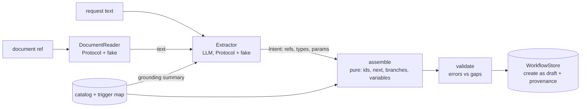
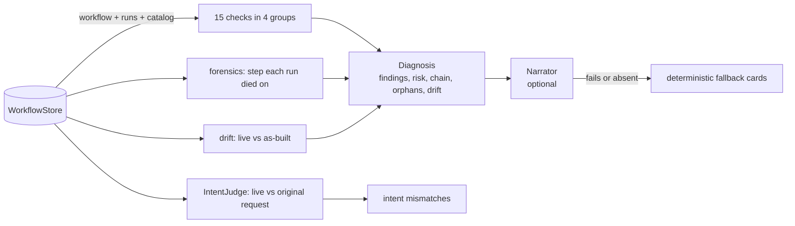

# workflow-doctor

Build automation workflows from plain language, and diagnose why existing ones fail and exactly how to fix them.

[](https://github.com/Tayyab-Bilal/workflow-doctor/actions/workflows/ci.yml)

> An open-source reference implementation of building and diagnosing automation workflows from plain language. All names and data are fictional.

## The problem

Customers automate processes in a workflow engine: a trigger, then steps, then TRUE/FALSE conditions.
Workflows break silently. Steps point at removed nodes, required settings are empty, conditions are not on
the engine's allow-list, drafts never fire, and runs fail with opaque errors. Building one by hand means
wiring a graph of GUIDs, and an LLM cannot be trusted to emit GUIDs or branch wiring.

This repo solves two jobs for a fictional "Acme Workspace" app. **Build** a workflow from a sentence or a
policy document. **Diagnose** an existing workflow and its run history: why it fails, what changed since it
was built, and the exact step, setting and value to fix. Both are plain functions, so a one-shot endpoint
and a conversational agent can share them and never disagree.

## What it does

- **Builds from text** (`build`): an LLM extracts structure and intent only; deterministic code makes every
  id, the next-step chain, TRUE/FALSE wiring and variable references. Always a draft. Missing values come back
  as `gaps`; impossible asks come back as `unsupported`. (`builder/`)
- **Builds from a document** (`build_from_document`): a `DocumentReader` turns a reference into text, which
  goes through the same pipeline. (`documents.py`)
- **Grounds the extractor** (`catalog_summary`): node allowed values, the condition allow-list, trigger
  payload fields, trigger phrases and the variable syntax. (`model.py`, `triggers.py`)
- **Validates in two tiers**: structural errors (duplicate ids, dangling pointers, missing branches, cycles by
  3-colour DFS) block; completeness gaps do not. (`builder/validator.py`)
- **Diagnoses** (`diagnose`, `analyse`): 15 deterministic checks in 4 groups, a risk level, the step chain in run
  order, orphans, and the exact step each failed run died on. (`doctor/`)
- **Reports three-way intent drift**: live vs as-built (steps added, removed, changed, with the as-built
  values) and live vs the original request through an `IntentJudge`. (`doctor/drift.py`)
- **Explains** (`narrate`): cause, evidence, numbered fix and impact cards, with a deterministic fallback when
  the narrator is missing or fails. (`doctor/narrate.py`)
- **Agent-facing operations** (`ops.py`): `find_by_name`, `copy_workflow`, `apply_edit`, `publish`, `revert`,
  `drift_edits`. Published workflows are immutable and there is no delete.
- **Seams** with in-memory fakes: `WorkflowStore`, `DocumentReader`, `Extractor`, `Narrator`, `IntentJudge`.

## Quickstart

```bash
uv venv .venv && uv pip install -e ".[dev]"
.venv/bin/pytest -q
.venv/bin/python examples/demo.py
```

No network and no API keys: every LLM sits behind a small Protocol with a scripted fake.

```python
import asyncio

from workflow_doctor import FakeExtractor, Intent, NodeIntent, build, diagnose, load_catalog

catalog = load_catalog()
intent = Intent(
    trigger=NodeIntent(ref="t", node_type="TaskCreated", then="n"),
    steps=[NodeIntent(ref="n", node_type="Notify",
                      params={"user": "{{trigger.owner_email}}", "message": "Task {{trigger.task_title}} created"})],
)
result = asyncio.run(build("when a task is created, notify the owner", FakeExtractor(intent), catalog))
print(result.workflow.status, result.gaps, result.unsupported, result.errors)
print(diagnose(result.workflow, catalog, runs=[]).risk)
```

Excerpt of the demo's output (it builds a workflow, diagnoses a broken one, then walks the agent-facing calls):

```text
=== 2. DIAGNOSE 'Onboarding' ===
risk: HIGH   chain: t1 -> s1 -> s2 -> s3 -> s4 -> s5   orphans: ['s9']

findings:
  [high  ] STEP_NODE_REMOVED      s5  Step s5 uses node LegacyChatPing, which no longer exists in the catalog.
  [high  ] EMPTY_REQUIRED_PARAM   s2  Step s2 has no value for required setting 'to'.
  [medium] INVALID_STATUS_PARAM   s4  Step s4 sets status='finished', which UpdateTaskStatus rejects.
  [low   ] ZERO_DELAY             s3  Delay step s3 waits 0 minutes, so it does nothing.
  [medium] UNREACHABLE_STEP       s9  Step s9 cannot be reached from the trigger.
  [high  ] ALL_RUNS_FAILED        -   All 3 recorded runs failed; the workflow has never worked.

where each run died:
  r3: failed before any step ran: trigger payload rejected
  r2: died on step s2 (SendEmail): recipient address is empty

=== 3. WHAT A CONVERSATIONAL AGENT CALLS (pure functions; the agent adds confirmation) ===
copy: 5 steps, all ids new: True, wait is now 60 min
drift keeps the as-built value: minutes was 1440, is now 0
revert restores the as-built graph: True
publish refused while a required setting is empty: body is missing
published workflows are immutable: workflow ... is published and cannot be edited
```

## Usage guide

The full guide is in [docs/usage.md](docs/usage.md) and every public name is listed in
[docs/api.md](docs/api.md). The main moves:

Analyse a stored workflow by id, or build one into a store:

```python
from workflow_doctor import InMemoryStore, analyse, build_and_store

store = InMemoryStore()
created = asyncio.run(build_and_store(store, "when a task is created, notify the owner", FakeExtractor(intent)))
saved = store.get_workflow(created.workflow.id)
print(saved.status, saved.built_from.source_text)
print([f.code for f in analyse(store, saved.id).findings])
```

Find, copy with an edit, and publish (what an agent does, after the user confirms):

```python
from workflow_doctor import Edit, apply_edit, copy_workflow, find_by_name, publish

hit = find_by_name(store, "when a task")  # names default to the request text
assert hit.outcome == "one"
wf = store.get_workflow(hit.workflow_id)
notify = next(iter(wf.steps.values()))
twin = copy_workflow(wf, [Edit(step_id=notify.id, set_params={"user": "lead@acme.example"})], name="Notify the lead")
print(twin.name, twin.status, set(twin.index()).isdisjoint(wf.index()))
live = publish(twin, catalog)
print(live.status)
```

## How it works





**Build.** `build` asks the extractor for an `Intent` (throwaway refs, node types, params, who points where).
`assemble` turns it into a `Workflow` by minting ids and rewriting pointers and `{{ref.field}}` variables. It
records provenance (the request, a document reference if any, and a snapshot of what it built). `validate`
splits problems into blocking errors and fillable gaps. A store creates the result as a draft.

**Diagnose.** `diagnose` runs the 15 checks, derives a risk level, orders the chain by walking both branch
edges, and names the exact step each failed run died on. Drift compares the live graph to the as-built
snapshot. Only keys the builder set are compared, so values the engine fills in later are not drift.

**The 15 checks, in the four groups the Doctor reports in** (`CHECK_GROUPS`):

| Group | Checks |
|---|---|
| Trigger | `NO_TRIGGER`, `TRIGGER_NOT_IN_CATALOG`, `TRIGGER_DEAD_END` |
| Step and parameter | `STEP_NODE_REMOVED`, `EMPTY_REQUIRED_PARAM`, `INVALID_STATUS_PARAM`, `BROKEN_POINTER`, `DEAD_VARIABLE` |
| Flow | `CONDITION_DEAD_END`, `CONDITION_NOT_ALLOWED`, `ZERO_DELAY`, `UNREACHABLE_STEP` |
| Execution health | `ALL_RUNS_FAILED`, `LAST_RUN_FAILED`, `ACTIVE_NEVER_RAN` |

`DEAD_VARIABLE` was added for the conversational agent: it catches a placeholder that looks filled but can
never resolve (its producer is not upstream, as when an engine backfills a stand-in).

**Answer contract.** Every card has a cause specific to this workflow, evidence (the check and the failed
runs), a numbered fix naming the exact step, setting and value, and the cost of leaving it.

## Design decisions

1. **The LLM extracts intent; code wires the graph.** Ids, chains, branches and variables come from
   `assembler.py`; any id the model supplies is dropped. *Rejected:* letting the model emit the graph. It
   produces made-up GUIDs and dangling branches.
2. **Catalog-first, and no faked conditions.** Anything not in the catalog goes to `unsupported`. An unknown node
   that had branches is reported as an unsupported condition, never replaced by a real one. *Rejected:* mapping
   an unknown condition to the nearest allowed one; it builds a workflow that does something else.
3. **Always a draft; gaps, not guesses.** A missing recipient is a `gap` for the user to fill. *Rejected:*
   inventing a default value.
4. **Two-tier validation.** Errors block creation; gaps do not. *Rejected:* one list, which either blocks
   half-finished drafts or lets broken graphs through.
5. **Reachability follows both branch edges.** *Rejected:* walking only the `next` spine, which reported the
   whole FALSE branch as unreachable.
6. **Gaps and findings match the exact step id, not the node type.** *Rejected:* keying by type, which blamed
   every step of the same type for one broken step.
7. **Drift compares only keys the builder set.** *Rejected:* comparing every key; engine backfill then looks
   like drift and produces false findings.
8. **Three-way drift, with the LLM only on the last leg.** Live vs as-built is deterministic. Live vs the
   original request needs reading comprehension, so it sits behind `IntentJudge`.
9. **Findings stand alone; the narrator only makes them readable.** Any narrator failure falls back to
   deterministic cards. *Rejected:* making the explanation depend on the LLM.
10. **Agent operations are pure and have no confirmation logic.** They return new objects and never save. The
    confirm gate belongs to the agent that calls them. Published workflows are immutable; there is no delete.
11. **One trigger map shared and pinned to the catalog by a test**, in both directions, so a new engine trigger
    fails CI until it is mapped.

## Testing

```bash
.venv/bin/pytest -q
.venv/bin/ruff check .
```

| Invariant | Test |
|---|---|
| The LLM never sets ids | `test_llm_never_sets_ids` |
| Unknown conditions are never faked | `test_unknown_condition_not_faked` |
| Missing values are gaps, not errors | `test_missing_required_param_is_gap_not_error` |
| Gaps match the exact step | `test_gap_matches_exact_step` |
| Reachability follows both branches | `test_reachability_follows_both_branches` |
| Cycles found, diamonds are not cycles | `tests/test_validator.py` |
| Engine backfill is not drift | `test_engine_backfill_is_not_drift` |
| Drift shows added, removed, changed steps with as-built values | `test_step_removed_added_and_changed_with_as_built_values` |
| The judge sees the live workflow and the original request | `test_intent_judge_compares_live_workflow_to_original_request` |
| Extractor is grounded (values, allow-list, payloads, syntax) | `tests/test_grounding.py` |
| Trigger map and catalog agree both ways | `test_every_mapped_trigger_exists_in_the_catalog`, `test_every_catalog_trigger_is_mapped` |
| 15 checks in 4 groups, each with a test | `test_fifteen_checks_in_four_groups`, `tests/test_checks.py`, golden workflows |
| Copy rewires every id, link and variable; edits in the same call | `test_copy_gets_new_ids_and_rewires_every_link_and_variable`, `test_copy_applies_edits_in_the_same_save_and_leaves_source_alone` |
| Published workflows cannot be edited or reverted | `test_apply_edit_refuses_published_workflow` |
| Revert restores the last as-built graph | `test_revert_restores_last_as_built` |
| Find: one proceeds, several asks, none says so | `test_find_by_name_one_several_none` |
| Stores create drafts and record provenance | `test_build_and_store_creates_a_draft_with_provenance` |
| Documents feed the same pipeline | `test_build_from_document_feeds_extracted_text_into_the_same_pipeline` |
| Narrator failure falls back | `test_narrator_failure_falls_back` |
| Docs examples run | `tests/test_docs.py` |

## Limits & known trade-offs

- Variables are rewritten in top-level string params only. Nested values need a recursive walk.
- The trigger flows into the first step by default; every other step needs an explicit `then`.
- Dropped unsupported steps leave their references unresolved. The Doctor then reports `DEAD_VARIABLE` or a
  missing branch, but the build does not warn about it directly.
- Step ids are dict keys, so duplicate step ids cannot exist in the model. `DUPLICATE_ID` guards a trigger/step
  clash and raw input that is checked before it becomes a dict.
- Termination is not checked per branch. Cycles and missing branches are; a path that simply ends is allowed.
- The risk level is a simple rule (worst severity, bumped one notch by failed history), not a score.
- Intent mismatches are only as good as the `IntentJudge` behind them. The default fake is scripted.
- The store is synchronous and in memory. The agent-facing functions do not persist anything; callers save.
- The conversational path costs more than the one-shot path (slower, many more tokens), which is why the endpoints stayed the product path.

## Project layout

```
src/workflow_doctor/
  model.py            domain model, graph walk, variable helpers, catalog grounding summary
  triggers.py         TRIGGER_MAP: natural phrase -> trigger type, pinned to the catalog by a test
  catalog.json        28 Acme nodes: 12 triggers, 13 actions, 3 conditions
  store.py            WorkflowStore Protocol, InMemoryStore, analyse, build_and_store
  documents.py        DocumentReader Protocol, fake, build_from_document
  ops.py              agent-facing pure functions: find, copy, edit, publish, revert
  builder/            extract (Protocol + fake), assembler (pure), validator, build
  doctor/             checks (15, in 4 groups), forensics, drift (three-way), diagnose, narrate
tests/golden/         healthy, broken onboarding, dead-variable workflows with expected codes
tests/test_docs.py    runs every python block in README.md and docs/
docs/                 usage.md (guide), api.md (reference)
examples/demo.py      end-to-end story with fakes
```

## License

MIT
